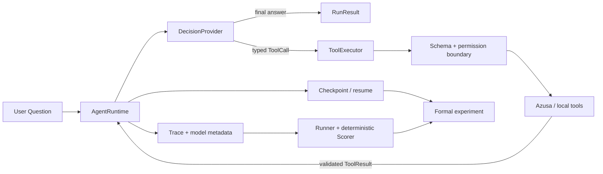

# Kaiji：可恢复、可评测的单 Agent Runtime

Kaiji 是一个以可靠性为主线的 Python Agent 工程项目。它从零实现类型化 Tool Calling、
有界循环、结构化失败、成功证据隔离与 Trace，再用 LangChain 和 LangGraph 对照框架如何
改变表达方式但不替代业务边界。Kaiji 通过 HTTP/Tool Adapter 调用独立的 Azusa RAG，
不复制其 HNSW、Hybrid、Rerank 或 Citation 实现。

这个项目研究的不是“怎样再做一个聊天机器人”，而是：

> 怎样让一个使用真实 LLM、工具和 RAG 的单 Agent，其行为可以被限制、恢复、观测、
> 评测和比较？

## 90 秒项目摘要

| 能力 | Kaiji 的实现 |
|---|---|
| Tool Calling | Pydantic/JSON Schema 输入输出契约，未知字段与非有限 JSON 拒绝 |
| 可靠执行 | 工具超时、至多一次重试、重复业务调用保护、最大步骤与明确停止原因 |
| 证据边界 | 只有成功且通过结果校验的工具结果能进入回答证据与引用评分 |
| 状态与恢复 | 区分 Message、AgentState、Checkpoint、Memory；LangGraph Interrupt/Resume 与 SQLite Saver |
| Provider | OpenAI-compatible HTTP 边界、失败分类、请求预算与 Token/延迟元数据 |
| Eval | Behavior/Fault Suite、确定性 Scorer、固定适用分母、Ablation 与 Bad Case |
| Formal | 数据/配置指纹、逐请求账本、Episode hash 链、断点续跑与未决请求阻断 |
| RAG 集成 | `search_azusa(query, k, mode)` 与 `get_chunk_by_id(chunk_id)` 稳定 Adapter |

历史冻结证据记录了 40 条真实行为题 × 3 次的 DeepSeek Formal：严格 Task Success
`116/120`；要求工具的 96 个 Episode 中 Tool Selection `96/96`、Argument Accuracy
`92/96`；24 个无工具 Episode 为 `24/24`，Citation Precision/Recall 均为 `1.0`。
这些结果来自受控 Mock 工具 fixture，不是开放域 Benchmark 或生产 SLA。完整口径见
[Eval 与 Bad Case](docs/portfolio/evaluation-and-bad-cases.md)。

## 架构



更完整的组件图、运行时序、LangGraph 状态机与 Formal 数据流见
[架构与状态图](docs/portfolio/architecture.md)。

## 为什么不用一个框架直接包完

Kaiji 先实现原生 Runtime，再对照 LangChain/LangGraph。框架可以减少消息、工具、节点、
边和 Checkpointer 的机械代码，但不会自动决定：

- 什么工具可以调用，输入输出如何校验；
- timeout 后是否可能仍发生副作用；
- 哪些失败可以重试，预算由谁控制；
- 什么结果能成为可信证据；
- Checkpoint 恢复是否会重复执行；
- Eval 的适用分母、数据污染和 Bad Case 如何定义。

横向职责表见 [原生 Runtime、LangChain、LangGraph 对照](docs/framework-comparison.md)。

## 可靠性机制

```text
模型响应
  ├─ 协议失败 ───────────────→ model_failed
  ├─ 最终回答 ───────────────→ completed
  └─ ToolCall
       ├─ 未知工具/参数非法 ─→ tool_failed
       ├─ 重复业务调用 ─────→ duplicate_call
       ├─ handler 失败 ─────→ 有预算且可重试时再试一次
       ├─ 结果 Schema 非法 ─→ tool_failed
       └─ 成功结果 ─────────→ 写入 Message、Trace 与成功证据

循环耗尽 ───────────────────→ max_steps
```

项目把失败按 Provider、Tool、Control、Evidence、State 和 Experiment 六层整理，并明确
每类失败的检测、缓解、可观测信号与剩余风险，见
[Agent Failure Taxonomy](docs/portfolio/failure-taxonomy.md)。

## Eval 不是一张满分表

Kaiji 刻意保留失败实验与方法学修正：

- 初版 Autonomous Pilot 因题集不适合自主模型且混入网络失败，被判定为方法学无效；
- Guided Pilot 泄露预期工具和参数，只能证明协议路径，不能证明自主选择；
- Scorer 曾把不适用样本当满分稀释指标，冻结审计后改为按适用 Episode 计算；
- Azusa Live 曾发生冷态工具超时，成功重跑没有覆盖首次失败记录；
- Formal 的四个严格 Bad Case 都保留，不能因功能回答正确而事后放宽参数金标。

这使报告回答“为什么失败、修正了什么、仍不能证明什么”，而不只输出一个成功率。

## 代码地图

| 入口 | 职责 |
|---|---|
| [`models.py`](src/kaiji/models.py) | Message、ToolCall、Result、Failure、Trace 与跨 artifact 不变量 |
| [`tools.py`](src/kaiji/tools.py) | Registry、Schema、timeout、有限重试与结果校验 |
| [`runtime.py`](src/kaiji/runtime.py) | 原生单 Agent 循环、重复保护、停止原因与成功证据 |
| [`langgraph_workflow.py`](src/kaiji/langgraph_workflow.py) | 条件边、查询改写、Interrupt、Resume 与线程隔离 |
| [`adapters/azusa.py`](src/kaiji/adapters/azusa.py) | 稳定语义接口、Legacy 兼容和 HTTP 失败分类 |
| [`providers/openai_compatible.py`](src/kaiji/providers/openai_compatible.py) | OpenAI-compatible 请求/响应协议与失败边界 |
| [`eval_runner.py`](src/kaiji/eval_runner.py) | Case 隔离并生成真实 Runtime Episode |
| [`eval_scorer.py`](src/kaiji/eval_scorer.py) | 确定性单条评分与固定分母聚合 |
| [`experiment.py`](src/kaiji/experiment.py) | Scripted 实验矩阵与 Reliability Ablation |
| [`formal_runner.py`](src/kaiji/formal_runner.py) | 预算账本、hash 链、逐 Episode 持久化和恢复 |

所有公开主张到代码、测试和报告的映射见
[证据索引](docs/portfolio/evidence-index.md)。

## 快速体验

要求 Python 3.11+。下面命令默认不需要 API Key 或正在运行的 Azusa：

```powershell
python -m pip install -e '.[dev]'
$env:PYTHONPATH = (Resolve-Path 'src').Path
python -m kaiji.demo
python -m kaiji.eval_demo
python -m kaiji.experiment --provider scripted --suite smoke
```

正式实验、真实 Provider 和 Azusa Live 都有独立预算与环境门槛，不属于默认体验路径。
推荐演示顺序、观察点与真实调用边界见 [命令行 Demo 指南](docs/portfolio/demo-guide.md)。

## 历史验证与结论边界

答案基线 `47cd4a5` 曾完成冻结审计，记录为 542 条测试中 541 passed、1 个未设置常驻
Live URL 时的 skip；Azusa BM25 Live 另行得到通过。本求职包装阶段没有重新运行测试、
模型请求或 Azusa 服务，因此这里引用的是既有审计证据，不是本次修改后的动态结果。

详细历史记录：

- [冻结审计](docs/freeze-audit-v0.2.md)
- [Reliability Eval v0.2 报告](docs/reliability-eval-v0.2-report.md)
- [Eval 契约](docs/reliability-eval-contract.md)
- [要求—实现—测试追踪](docs/reliability-eval-traceability.md)

## 分支职责

| 分支 | 用途 |
|---|---|
| `main` | 作者亲手完成课程 TODO 的学习进度 |
| `solution/kaiji-v0` | 完整答案与历史审计基线 |
| `portfolio/kaiji-v0` | 本页所在的求职展示与证据组织分支 |

## 求职材料

- [岗位能力矩阵](docs/portfolio/job-market-matrix.md)
- [中英文简历项目描述](docs/portfolio/resume-bullets.md)
- [Interview Adversary](docs/portfolio/interview-adversary.md)

## 明确非目标

Kaiji v0 不实现 Multi-Agent、复杂长期记忆、任意代码执行、浏览器自动化、生产级
Prompt Injection 防护、Kubernetes、分布式 Runtime、vLLM 内核或大型 MCP 生态。
FastAPI、Docker、CI 和 OpenTelemetry 属于 P2 候选，不在本分支当前完成范围内。
