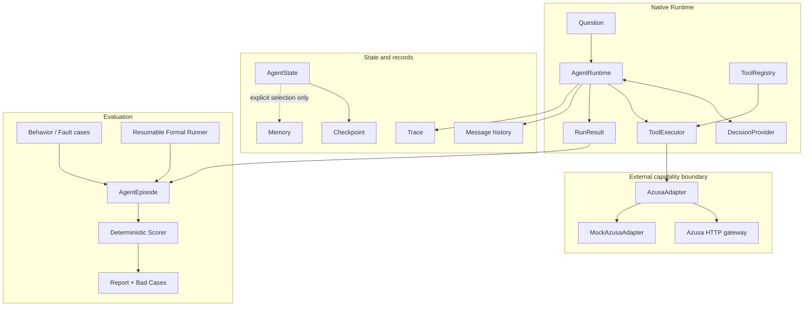
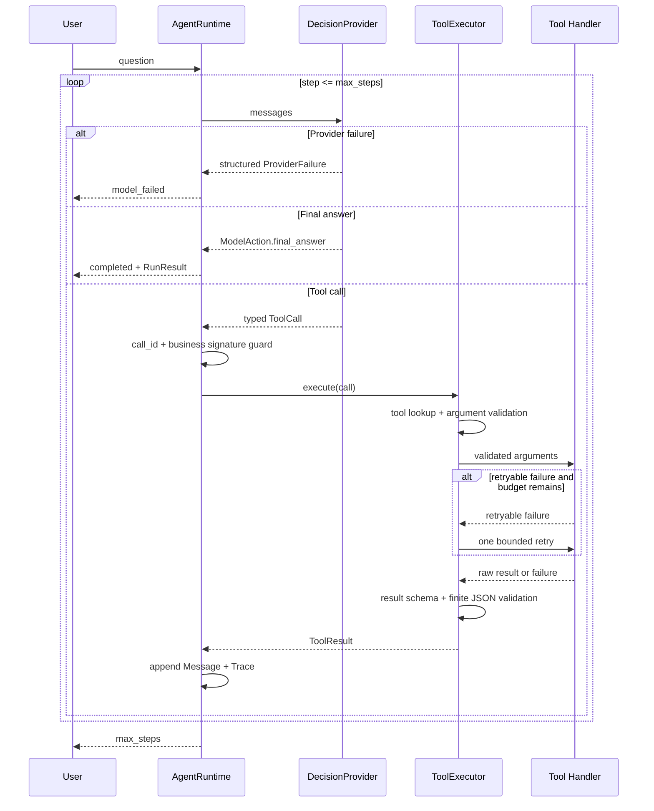
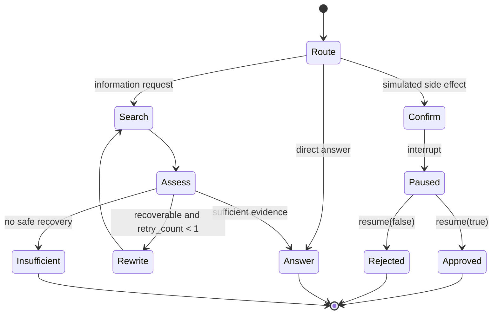
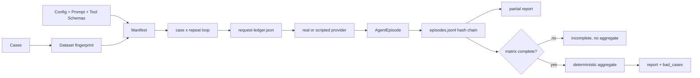

# Kaiji 架构与状态图

本页只描述 `portfolio/kaiji-v0` 已有实现。图中的虚线边界表示实验或框架对照，不代表
一个生产部署拓扑。

## 组件关系

## 原生 Runtime 时序

关键不变量：失败工具结果会进入消息和 Trace 供审计，但当前 Runtime 随即停止，不再把
该失败回合发送给模型；只有成功且校验后的
`ToolResult` 能进入 `successful_tool_results`，成为引用支持证据。

## LangGraph 工作流

`step_count` 统计实际搜索次数，`retry_count` 统计 query rewrite 次数；二者不能互换。
副作用路径只模拟批准/拒绝，不执行真实外部写操作。

## State、记录与持久化边界

| 对象 | 回答的问题 | 生命周期 | 禁止混用 |
|---|---|---|---|
| `Message` | 模型实际看到了什么 | 一次对话，可裁剪 | 不能自动当长期记忆 |
| `AgentState` | 当前工作流在哪里、下一步是什么 | 一次运行或 thread 恢复 | 不能直接当 Trace |
| `Checkpoint` | 中断后从哪个完整快照恢复 | thread/checkpoint 标识 | 不等于业务 Memory |
| `Memory` | 应用选择跨会话保留什么 | 按 user 隔离 | 不能无筛选保存 history |
| `TraceEvent` | 某一步发生了什么 | 追加记录 | 不能进入模型上下文冒充证据 |
| `AgentEpisode` | 一次被评分的实际运行 | case/repeat 坐标 | 不能与金标 Case 混为一体 |

## Formal 实验数据流

恢复时会重新核对 Manifest、预算账本、Episode 坐标和 hash 链。若已有请求开始但没有
对应完成记录，系统以 `unresolved_request` 停止人工审计，不把未知 Token 成本当成零。

## 架构取舍

- 原生 Runtime 暴露边界，便于解释 failure、retry、evidence 和 stop reason；代价是
  组合代码多于直接使用框架。
- LangGraph 适合显式状态机、Interrupt 和 Checkpoint，但不自动提供业务幂等、严格审批
  或长期 Memory 策略。
- JSON/JSONL Store 适合教学和可审计小闭环，不证明并发写入或分布式一致性。
- Formal hash 链能发现未重算的损坏，但没有密钥签名和外部可信锚点，不证明真实性。
- 线程超时无法终止已开始的 Python handler；当前可重试 Azusa 工具只读，有副作用工具
  必须采用幂等键、外部状态核对或不同的执行隔离方案。
