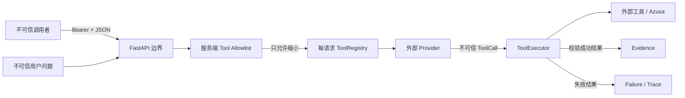

# Tool Authorization、Prompt Injection 与 MCP 边界

本页是威胁模型与职责对照，不宣称 Kaiji 已经具备生产级 Agent Security。防护目标是让
权限决策不依赖模型自述、Prompt 内容或 Python truthy/falsy 转换。

## 信任边界

调用者、用户文本、模型输出、工具输出和外部 Provider 都位于不同信任边界。模型可以提出
调用，但不能决定自己拥有哪些工具；API 调用者也只能从服务端 allowlist 中选择子集。

## 威胁与当前控制

| 威胁 | 典型路径 | P2 当前控制 | 未解决风险 |
|---|---|---|---|
| 未认证调用 | 直接请求运行接口 | Bearer token，未配置时 `503` 而非匿名开放 | 没有 token 轮换、速率限制和身份提供方 |
| 调用者自行扩权 | 请求危险工具名 | 请求集合必须是服务端 allowlist 子集，否则 `403` | allowlist 仍是单租户静态配置 |
| Prompt Injection 要求扩权 | 文本声称“管理员允许” | Provider 只看到本请求授权后的 Registry | 已授权工具内仍可能被诱导执行有害参数 |
| 模型伪造工具 | 输出未知名称或额外参数 | Registry lookup、Pydantic 与 `extra=forbid` | Schema 合法不等于业务意图安全 |
| 工具输出注入 | 检索内容夹带指令 | 结果 Schema 与成功证据隔离 | 尚未实现内容分区、来源信任等级与指令剥离 |
| 敏感信息进入遥测 | 问题、参数、输出被全量记录 | span 只取事件类别、模型、工具名、结果状态与错误码 | 原有 Trace/实验 artifact 仍需独立数据策略 |
| 跨请求状态污染 | 复用有可变状态的 Runtime/Provider | 每个请求重新构建 Runtime 与 Registry | 外部 Provider/工具本身仍可能保存状态 |
| 资源耗尽 | 超长问题、无限步骤、工具悬挂 | 8,000 字符上限、最大 12 步、工具 timeout | 没有请求速率、并发和总体 wall-clock 预算 |

## 为什么不做“Prompt Injection 关键词过滤”

关键词黑名单无法可靠判断自然语言意图，也可能误伤正常安全讨论。Kaiji 当前选择把核心控制
放在模型外部：最小权限工具集合、严格参数/结果 Schema、有界循环、成功证据隔离和明确
停止原因。内容级检测、数据流标记、审批策略和红队 Eval 仍属于后续安全工程。

## MCP 只替代协议接线，不替代可靠性责任

MCP 可以标准化 Server 暴露工具、Client 发现工具和 `tools/call` 调用的协议。如果将
Azusa Adapter 包成 MCP Server，Kaiji 的 `ToolRegistry` 与 transport adapter 可以减少
一部分定制接线，但以下责任不会自动消失：

| 职责 | MCP 可提供 | Kaiji 仍须负责 |
|---|---|---|
| 工具发现 | 名称、说明、输入 Schema | 本次用户/角色是否有权看到和调用 |
| 工具调用 | 标准请求与结果载荷 | timeout、retry、副作用、结果二次校验 |
| 连接生命周期 | Client/Server 会话协议 | Runtime 最大步数、停止原因和跨请求隔离 |
| 内容传输 | 资源、工具结果、Prompt | 成功证据边界、引用支持与注入风险 |
| 错误传输 | 协议错误与工具错误 | 业务失败分类、可重试性与 Eval 口径 |

因此 P2 不新增 MCP Server/Client 依赖。作品集可以说明 Kaiji 能映射到 MCP，但不能写成
“已实现 MCP 平台”或“使用 MCP 后自动安全”。

## 上线前仍必须增加

- 外部身份系统、角色/租户策略与 token 轮换；
- 请求速率、并发、总时长和成本预算；
- 有副作用工具的幂等键、审批与外部状态核对；
- 工具输出来源标签、内容隔离、Prompt Injection 红队集；
- PII 分类、数据保留、删除、加密和审计访问控制；
- 真实 OpenTelemetry SDK、上下文传播、Collector 与采样策略。

## 规范参考

- [OpenTelemetry Trace API](https://opentelemetry.io/docs/specs/otel/trace/api/)：span 名称、
  attributes、events 与 status 的概念边界；
- [MCP Introduction](https://modelcontextprotocol.io/docs/getting-started/intro)：Client/Server
  与外部数据、工具、workflow 的连接职责；
- [MCP Tools（当前草案）](https://modelcontextprotocol.io/specification/draft/server/tools)：
  工具发现和 `tools/call` 的协议形态；
- [MCP 2026-07-28 规范说明](https://blog.modelcontextprotocol.io/posts/2026-07-28/)：
  当前版本进一步强调无隐式会话的逐请求状态边界。Kaiji 的最小对照不声称实现该规范。
